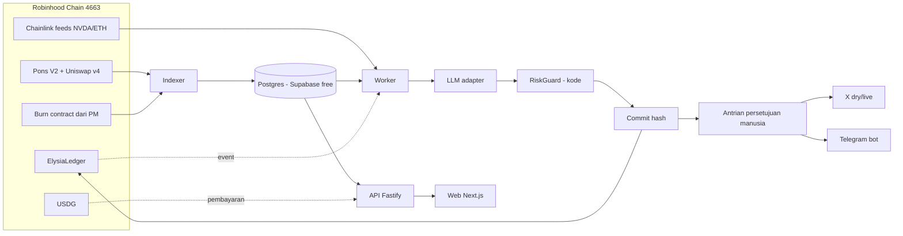

# ELYSIA — Arsitektur Target (Robinhood Chain)

Status: rencana akhir untuk branch `dev-rh` (2026-11-13). Dasar: arahan developer, kode di repo, dan verifikasi baca-saja ke RPC mainnet.

## 1. Batasan yang mengikat
- Satu chain: **Robinhood Chain mainnet, chain ID 4663**. Tanpa chain lain, bridge, atau multichain.
- Kontrak ditulis baru (`ElysiaLedger`, kelak token $ELYS); tidak ada alamat lama yang dipakai. Tidak ada BurnVault dan tidak ada splitter fee kreator.
- Tiga wallet: Deployer (deploy dan admin), Agent (commit dan reveal), Treasury (penerima USDG). Private key berbeda; tidak ada Keeper di mainnet.
- Mainnet: tidak ada deploy atau transaksi tanpa persetujuan eksplisit per tindakan.
- Konten publik berbahasa Inggris; disclaimer "Not affiliated with Robinhood".

## 2. Komponen

| Komponen | Isi | Catatan |
|---|---|---|
| Kontrak | `ElysiaLedger` | commit/reveal prediksi; membaca feed Chainlink langsung. Lihat `ELYSIA_SMART_CONTRACT_PLAN.md` |
| Indexer (`apps/indexer`) | Pons V2 (launch, trade, graduation), holder, whale, burn | Burn dibaca dari `BURN_CONTRACT_ADDRESS` (CA PM); event menunggu ABI |
| Worker (`apps/worker`) | Prediction of the Day, laporan harian dan Pons, pulse, mention, Telegram, X | LLM Xiaomi MiMo (kompatibel OpenAI); tanpa kunci memakai mock |
| RiskGuard (`packages/riskguard`) | Aturan konten berbasis kode, fail-closed | Memblokir buy/sell, price target, klaim afiliasi Robinhood/Pons, sebutan $ELYS |
| API (`apps/api`) | proof, prediksi, rug-radar, market, leaderboard, burn, ask, pricing; berbayar: auth (SIWE), pro, alerts, signals | Berbayar mati sampai `PAID_FEATURES_ENABLED=true` |
| Web (`apps/web`) | Landing, Proof, Prediction of the Day, Rug radar, Ask, Burn, Leaderboard, Pro, Signals, Sponsored | Tampilan dan palet warna tidak diubah |
| DB (`packages/db`) | Drizzle; migrasi 0000–0012 | Project Supabase baru |

## 3. Pipeline dan integritas bukti
AI → RiskGuard → commit terkonfirmasi → antrian persetujuan manusia → post. Hash `keccak256(abi.encode(string,address,uint8,uint32,bytes32))` di-commit sebelum publikasi; salt dan preimage terenkripsi (`PREIMAGE_KEY`) dan tidak pernah di log; tx hash disimpan. Mode X `dry` sampai izin eksplisit untuk `live`; balasan manual.

## 4. Fitur berbayar
- Harga di env dan disajikan `GET /pricing` (cache 15 detik); web membaca endpoint itu.
- Pro: pembayaran USDG ke Treasury, diverifikasi on-chain terhadap harga yang sama; sesi login wallet (SIWE); alert stream dan Telegram.
- Signals API: kunci API (`x-api-key`) diterbitkan setelah pembayaran lewat kontak, batas laju per kunci.
- Sponsored: dijual lewat kontak; label wajib, tanpa rekomendasi, tinjauan manusia.
- USDG kemungkinan proxy (kode pendek): admin kontrak berada di pihak ketiga.

## 5. Batas keamanan
1. Peran sempit: Agent hanya `commit`/`reveal`; owner kontrak = Deployer.
2. Private key tidak ke repo, `.env` repo, log, atau chat. Key Agent diisi manusia di dashboard.
3. RiskGuard berbasis kode; data hanya dari indexer dan oracle; data tidak lengkap berarti "tidak tahu".
4. Tidak ada resource, wallet, atau kredensial proyek sumber.
5. API publik hanya baca kecuali endpoint berbayar; batas laju menjaga biaya dan egress.

## 6. Risiko utama
- **Oracle Chainlink:** `ElysiaLedger` memverifikasi ronde awal dan akhir dengan `roundId ± 1`; di feed proxy Chainlink, id ronde memuat phase sehingga aturan itu hanya valid dalam satu phase. Heartbeat feed menentukan kapan ronde setelah jatuh tempo tersedia. Perlu ditinjau sebelum deploy (Phase C).
- **Mainnet:** kesalahan konfigurasi aset atau feed tidak dapat dibatalkan tanpa transaksi baru.
- **Supabase free:** batas egress dan ukuran; lihat `ELYSIA_DATABASE_OPTIMIZATION.md`.
- **Pihak ketiga:** USDG proxy, Pons V2 dapat berubah.
- **Hukum:** fitur berbayar dan token perlu tinjauan sebelum dibuka.

## 7. Verifikasi
Dicek terhadap `contracts/src/ElysiaLedger.sol`, `packages/shared/src/chains.ts`, `apps/api/src/app.ts` dan `server.ts`, `apps/worker/src/main.ts`, `packages/db/src/schema.ts`, serta pemeriksaan baca-saja ke `https://rpc.mainnet.chain.robinhood.com`.
