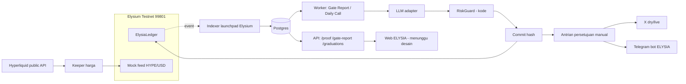

# ELYSIA — Arsitektur Target

Status: DRAFT planning (2026-11-11). Belum ada implementasi. Sumber: `docs/ELYSIA_BRIEF.md` (9 Nov 2026), arahan Head Dev, audit repository (Graphify + verifikasi source).

## 1. Batasan yang mengikat
- Satu-satunya chain: **Elysium Testnet, Chain ID 99801**. Tanpa Solana, tanpa chain lain, tanpa bridge, tanpa multichain, tanpa Robinhood Chain.
- Token ELYSIA, tokenomics, kontrak fee, `BurnVault`, mekanisme burn, logic Pons V2: di luar scope (ditunda).
- **Keputusan final Head Dev (2026-11-12): ELYSIA adalah layanan gratis.** Tidak ada paket Pro, subscription, pembayaran, kredit, USDG, Ask berbayar, Signals berbayar, maupun konten sponsor sebagai fitur ELYSIA. Tidak ada Treasury Wallet.
- **Tepat tiga wallet baru, independen dari NEXA, dengan tiga private key berbeda:** (1) Deployer: deploy dan administrasi kontrak (owner); (2) Agent: `commit`/`reveal` dan atestasi sesuai izin kontrak; (3) Keeper: tugas keeper dan operasional oracle sesuai izin kontrak. Wallet belum dibuat dan tidak ada private key yang dimasukkan pada tahap planning.
- Tidak ada deployment selama planning. Wallet, repo, infrastruktur, bot, dan kredensial semuanya baru dan terpisah dari NEXA.
- Konten publik berbahasa Inggris; disclaimer wajib: "Not affiliated with Kinetiq or Elysium."

## 2. Kondisi repository saat ini (hasil audit)
Repository adalah salinan NEXA: monorepo pnpm + Turborepo, 162 file kode dalam scope Graphify (1.450 node, 3.210 edge, 74 community; 16 file Solidity ikut). Tidak ada `.git` dan tidak ada `.github` di salinan ini (riwayat dan remote tidak dapat diaudit; CI tidak ada, hanya `.githooks/`).

| Area | Isi saat ini (terverifikasi) |
|---|---|
| `contracts/` | `NexaLedger`, `BurnVault`, `FeeSplitter` (+ `CreatorFeeSplitter`, `ProtocolFeeSplitter`), mock, 5 script deploy |
| `apps/worker` | siklus prediksi, antrian + RiskGuard, keeper harga mock, LLM adapter (API kompatibel OpenAI), X, Telegram, laporan |
| `apps/api` | Fastify; 20 route (proof, rug-radar, burn, ask, pro, signals, auth, leaderboard, market, dll.) |
| `apps/indexer` | indexer TS sendiri untuk Pons V2 (bukan Envio), burn, holder |
| `apps/web` | Next.js dengan branding NEXA (40 kemunculan "nexa" di `src` dan `public`) |
| `packages/*` | `shared` (chains, commit-reveal, scoring), `riskguard`, `db` (Drizzle), `api-client`, `contracts-abi` |

## 3. Arsitektur target (ringkas)

Aliran Gate Report (brief bagian Purpose + 9.1): Token Discovery → Data Collection → Risk Analysis → RiskGuard → Hash Generation → On-chain Commit (tx terkonfirmasi) → Report Publication → Historical Record. Urutan ini sama dengan aturan pipeline NEXA (AI → RiskGuard → commit → antrian → post) sehingga struktur `queue.ts` dan `cycle.ts` bisa dipakai ulang.

## 4. Komponen
| Komponen | Target | Catatan |
|---|---|---|
| Smart contract | `ElysiaLedger` di 99801 | Lihat `ELYSIA_SMART_CONTRACT_PLAN.md`. Keputusan Head Dev diperlukan (§Keputusan 1) |
| Indexer | Launchpad Elysium (Pump.fun, Ascend, Montra) | **Alamat launchpad belum dikonfirmasi** (TODO di `chains.ts`). Blok ~130 ms: `getLogs` batch besar. Deteksi bundling = banyak wallet membeli di blok yang sama |
| Worker | Gate Report, Graduation Watch, HYPE Daily Call, Weekly recap | Pakai ulang kerangka NEXA; prompt persona baru |
| LLM adapter | Pakai ulang `llm.ts` | Penyedia/kunci baru; validasi zod + retry sudah ada |
| RiskGuard | Pakai ulang, tambah aturan | Lihat `ELYSIA_MIGRATION_PLAN.md` §RiskGuard |
| API | `/proof`, `/gate-report`, `/graduations` | Hanya tiga endpoint publik dari brief + `/healthz`. Gratis; endpoint NEXA berbayar (`/ask`, `/pro/*`, `/signals*`, `/alerts/stream`, `/auth/*`, `/me`) tidak dibawa |
| Web | Fork, desain baru | Aset/desain/logo **pending**; jangan pakai aset NEXA |
| Telegram | Bot baru, kredensial baru | Arsitektur `telegram.ts` jadi referensi. Notifikasi gratis untuk semua pengikut; tanpa penautan wallet/langganan (`pro.ts`, tabel `telegram_links` berbasis alamat pelanggan tidak dibawa) |
| X | Akun "Automated", `dry` dulu, balasan manual | Tanpa auto-reply |

## 5. Batas keamanan
1. Tiga wallet baru dengan peran sempit dan key berbeda: Deployer (owner kontrak), Agent (hanya `commit`/`reveal`/atestasi), Keeper (hanya operasi feed). Tidak ada Treasury, tidak ada penerima fee, tidak ada aliran dana masuk. Agent dan keeper bukan owner dan tidak menerima dana selain gas HYPE dari faucet.
2. Salt/preimage terenkripsi (`PREIMAGE_KEY`), tidak pernah di log (pola sudah ada di `crypto.ts`/`keys.ts`).
3. RiskGuard berbasis kode, bukan AI; semua post lewat RiskGuard; data hanya dari indexer dan oracle.
4. Tidak ada koneksi ke Railway/Supabase/Vercel/Telegram/X milik NEXA. Lihat checklist infrastruktur.
5. Public API hanya baca dan gratis; tanpa auth wallet (SIWE), tanpa API key berbayar, tanpa verifikasi pembayaran. Rate limit tetap diperlukan untuk melindungi biaya dan egress, bukan sebagai paket.

## 6. Risiko arsitektur utama
- **Oracle HYPE:** `MockAggregator.push(answer, updatedAt)` terbuka untuk siapa pun dan `updatedAt` bebas (terverifikasi di `contracts/test/mocks/MockAggregator.sol`). Keeper menyalin harga dari API Hyperliquid. Skor testnet hanya "layak uji mesin", bukan bukti akurasi. Mainnet: precompile HyperCore belum boleh diasumsikan; model `getRoundData` NexaLedger mungkin tidak cocok dengan precompile (tidak ada riwayat ronde). Lihat dokumen kontrak.
- **Indexer launchpad:** sumber data bergantung pada alamat/ABI yang belum diverifikasi.
- **Bentrok nama "Elysia":** brief menandainya sebagai risiko utama; di luar lingkup teknis.

## 7. Verifikasi
Temuan di atas diverifikasi terhadap file: `contracts/src/NexaLedger.sol`, `contracts/test/mocks/MockAggregator.sol`, `apps/worker/src/keeper.ts`, `packages/shared/src/chains.ts`, `packages/contracts-abi/addresses/*.json`, `packages/db/src/schema.ts`. Edge/community Graphify tidak diperlakukan sebagai fakta tanpa pemeriksaan ini.
